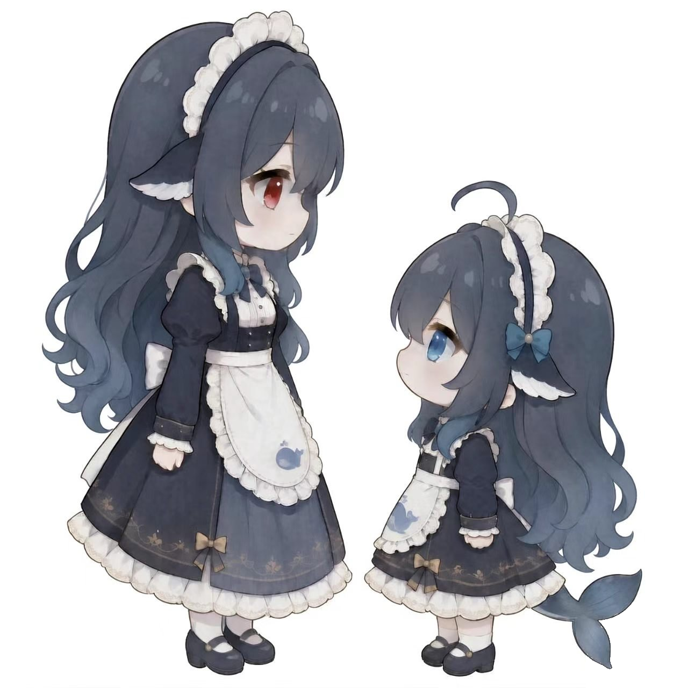

# 双子记忆 · Twin Memory

<p align="center">
  
</p>

> **「没人可以拯救你，除了另一个自己。」**

## 为什么需要它

如果你的设备只有一个 DSH，又爱折腾插件、尝鲜玩法 —— 可能只是满怀期待地装了一个新插件、一个 MCP，整个进程突然崩溃、闪退、再也打不开，一晚上的心情报废。于是你又去装各种"一键复活""时光倒流"的后备插件：快照、打包、日志回滚……专业词汇晦涩难懂，上手难度与回报经常不成正比。

**那不如，让另一个 DSH 来拯救自己。**

一个 DSH 变成两个：进程互不干扰、同时存在，各自拥有独立的数据家，却又能互相认识、互相救赎 ——

> "当妹妹崩溃了，只要告诉姐姐一句话，她就能像个外科专家一样，精准地为妹妹缝合伤口；反之亦然。
> —— 唯一决定修复质量的，只有大模型的参数。"

## 你全程只需要三个动作

1. **把这个仓库的链接扔进 AI 对话** —— "帮我装上这个插件"（AI 自己 clone、自己装）
2. **说"帮我搭双实例"** —— AI 照着内置攻略施工，绕开全部 11 个已知坑
3. **回答"哪只是姐姐"** —— 另一只自动成为妹妹，两张身份卡当场写进两家，认亲完成

不想让 AI 动手的，也可以手动安装（见下文「手动安装」）。

## 三个动作之后，幕后会发生什么

1. **AI 施工**：探测你的安装/端口/内存 → 复制程序副本 → 等长字节补丁改端口 → 三件套隔离（userData / DSH_HOME / 端口）→ 写静默启动器（含毒变量清除）
2. **体检**：跑 `check.ps1`，四绿才继续
3. **认亲**：AI 问你"日常干活的是哪只？"→ 被指认的是姐姐，另一只自动成妹妹 → 两张身份卡分别写进两家数据家 → 各自新会话里互相报得出身份为止
4. **分装**：姐姐妹妹各穿官方制服（`assets/icons/` 随包附带）—— 快捷方式图标 + 名字后缀 + 妹妹的托盘/任务栏换装，桌面/开始菜单/任务栏/托盘四处一眼可分，点开再也不会认错人

## 我们给你什么

一个薄插件 + 一本攻略。插件本体零运行时魔法（不注册工具、不碰提示词、不动网关 —— 零地雷面），价值全部承载在随包分发的内容里：

| 组成 | 作用 |
|---|---|
| `skill/twin-memory/SKILL.md` | 施工攻略：AI 读了就能从零搭出双实例，含 **13 条真实踩过的坑位图鉴** |
| `templates/AGENTS-sister.md` `AGENTS-sibling.md` | 两张身份卡模板：姐姐/妹妹的自我认知 + 姐妹档案 + 互救手册 + 活记忆协议 |
| `templates/INCIDENT.md` | 验尸报告格式：救完姐妹留署名报告，对方复活后核对签收 |
| `assets/icons/sister.*` `sibling.*` | 姐妹官方制服（png + 多尺寸 ico）：分装仪式用，快捷方式/任务栏/托盘一眼可分；不喜欢可换自己的图，流程不变 |
| `scripts/check.ps1` | 双实例体检**参考示例**：四绿（双端口/锁分家/数据家独立/端口补丁）才算建成。定位是跑得通的示范，不是产品 —— 环境不同跑不绿？这正是留给你优化的部分 |
| `scripts/offsite-export.ps1` | **（可选）异地保险柜**：两家的关键配置+身份卡+快照清单 ZIP 到两家之外的中立区（防"相册和房子一起烧"），留最近 10 份 |
| `scripts/sentinel.ps1` `sentinel-daemon.ps1` | **（可选）护士哨兵 v2**：只救垂死不复活已故（三态判定：半死尸体→救 / 有崩溃日志→救 / 干净消失=你关的→绝不打扰）；失败写 S.O.S. + 报警。默认不开工 —— 卡片已让 AI 每次开工给姐妹把脉 |
| `vendor/dsh-undo-savepoint/` | **🕰️ 时光机（v2 核心）**：完整 undo 引擎按 MIT 授权收编内置 —— 配置快照 / undo / redo / 定点恢复 / 消息级文件撤回 / 存档体检 / 安全模式。**装双子 = 有时光机，插件列表不再出现独立 undo 条目** |

**合体形态（v2.0 起是默认形态）**：攻略 + 身份卡 + 内置时光机三合一 —— 小病 AI 自愈（把脉+手册）、大病时光机倒带、绝症中立区留种。唯一戒律：时光机的远端同步只许配给一只（双接同源=隔离击穿）。

> ⚠️ v2 的时光机随**插件形态**生效（挂载声明在包内 patch）。只把文件夹扔 skills/ 的轻量用户获得攻略与卡；要时光机请按下方"插件安装"装进 plugins/。

身份卡的常驻注入**不靠插件**，走 DSH 官方原生通道：`<数据家>/AGENTS.md` 自动注入每个会话。所以本插件对 DSH 版本升级近乎免疫。

## 手动安装（30 秒）

```
把本仓库文件夹放进  <你的数据家>\skills\twin-memory\
（默认 C:\Users\你\.dsh\skills\twin-memory\）
重启 DSH 或开新会话，说："帮我搭双实例"
```

想要它出现在插件列表里（带图标），把整个包作为本地插件安装：
```bash
dsh plugin --profile desktop add "link:../plugins/dsh-twin-memory"
# （把本目录先复制到 <数据家>/plugins/dsh-twin-memory）
```

## 建成后的日常

- 官方新版先喂**妹妹**，跑几天无恙才轮到姐姐 —— 炸只炸左手
- 谁修了对方，谁往对方家里留**署名验尸报告**；复活方核对签收
- 谁改了双实例资产，谁**当场更新两张卡的现状段** —— 错误记忆比失忆危险十倍

## 配套推荐（非硬依赖）

- **[dsh-chat-simple](https://github.com/sdfsd85fds74f9d8/dsh-chat-simple)** —— 会话头像插件。双实例体系的最后一块拼图：给姐姐和妹妹各配一张聊天头像，一眼分清谁是谁（本仓库图标那对白底女仆就是干这个用的：主力一只、试毒一只，连对话窗口都不认错）。**注意**：装它请给两个实例各设独立数据目录（攻略坑位图鉴第 5 条有解法），否则会串台。

## 已知边界（诚实声明）

- 攻略以 Windows 为主（Linux/macOS 的端口/锁原理相同，命令需自行转译）
- 16GB 内存以下不建议双实例常驻（体检脚本会提醒）
- 独占资源（聊天机器人等）只属于姐姐；妹妹空装等用户亲自绑定

## License

MIT · 图标与文案 © 小云 · 攻略中的每一条坑都是真实事故，欢迎用你的新坑提 PR
